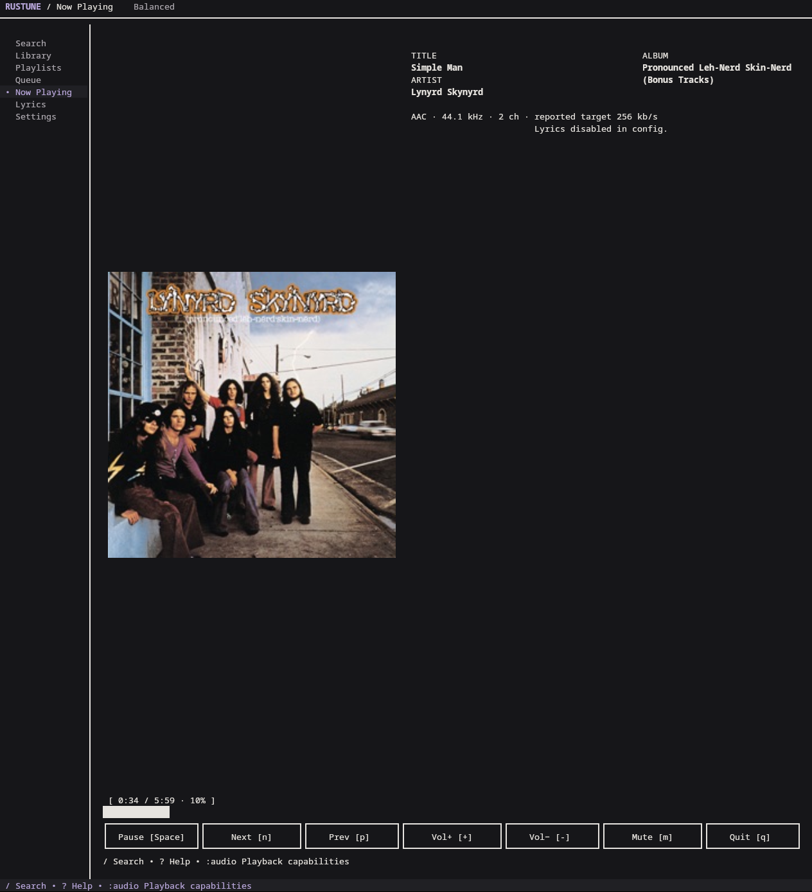
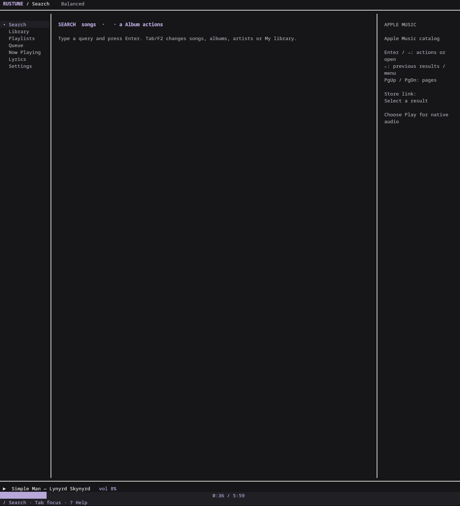
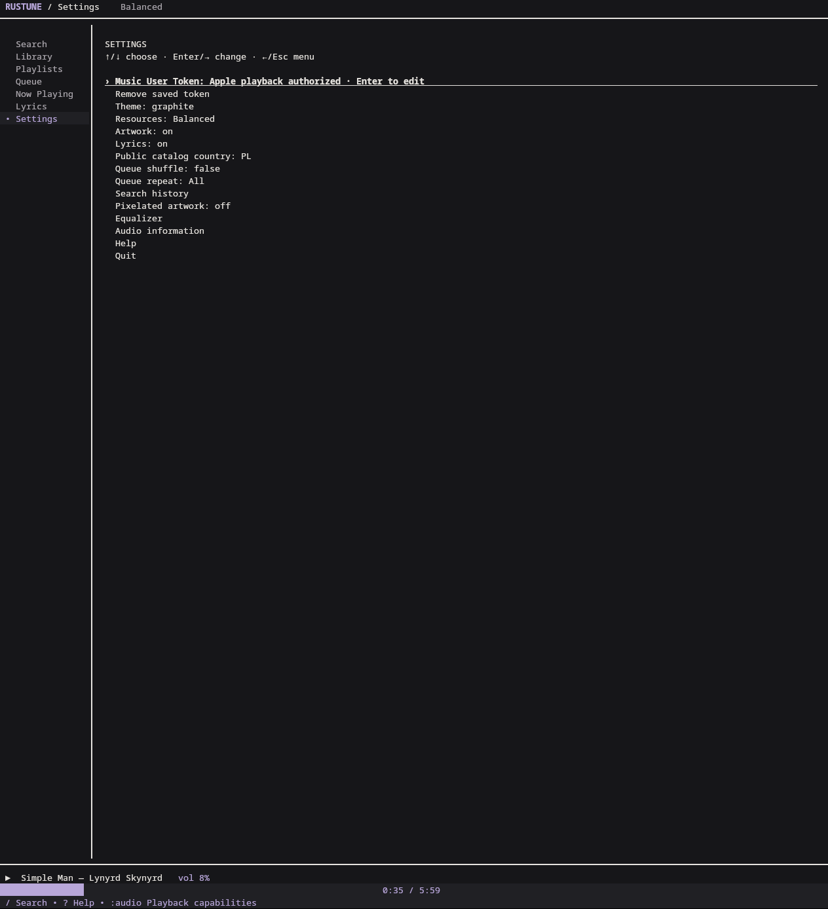

<div align="center">

# Rustune

**Apple Music, in your terminal.**

A native Linux player written in Rust. Graphite panels, one accent, and a small set of views that stay out of the way of your music.

[Install](#installation) · [Screenshots](#screenshots) · [Settings](docs/configuration.md) · [Keys](#keys) · [Resource usage](#resource-usage) · [Changelog](CHANGELOG.md)

</div>

## Features

- **Native playback.** A separate audio helper handles the local CDM, AAC decoding and ALSA/PipeWire output. No browser process or Music Assistant runtime.
- **Find your music.** Search songs, albums and artists, open complete albums, and browse your library and playlists. Search is the starting view.
- **A useful queue.** Play next, append, reorder, remove, shuffle, repeat and undo. Duplicate songs retain distinct queue identities; saved queues do not start playing by themselves.
- **Lyrics on their own.** Open a dedicated Lyrics view, follow the current verse or scroll at your own pace. Preview another song's lyrics without interrupting playback.
- **Your choice of cover.** Keep the pixelated terminal look or switch to a regular image in a compatible Kitty/iTerm2 terminal. One setting applies everywhere. Unsupported terminals explain the limitation; they do not silently substitute pixels.
- **Settings that do something.** Themes, artwork, lyrics, resource profiles, local token storage and a real ten-band equalizer. Audio information describes the actual backend; unavailable quality modes are not pretend controls.
- **Keyboard first.** Seven main destinations, consistent back navigation, configurable shortcuts and mouse scrolling. Help shows your current bindings.
- **Bounded background work.** Lazy artwork, one source image and one rendered cover, cached lyric wrapping, bounded result pages and redraws when visible state changes.

Rustune is experimental. A saved token means **saved locally**, not authenticated. Playback requires an active Apple Music subscription, accepted user credentials and a compatible proprietary CDM installed privately. A Music User Token alone is not a playback engine.

## Screenshots





<details><summary>Settings</summary>



</details>

Screenshots and their validation context are recorded in the [current validation report](docs/validation/2026-11-15-clean-tui.md). The layout is inspired by [Yami](https://github.com/Trendorin/yami); Rustune remains a terminal application.

## Installation

Linux, stable Rust **1.99.1** (minimum 1.99), a UTF-8 terminal and D-Bus. Install native build dependencies following the [installation guide](docs/installation.md), then:

```sh
scripts/build-slim-audio.sh
install -Dm755 target/release/rustune ~/.local/bin/rustune
install -Dm755 target/release/rustune-audio ~/.local/bin/rustune-audio
rustune init
rustune login
rustune
```

Keep both executables together. The build script verifies and builds a private minimal FFmpeg; it does not replace system libraries. A standard `cargo build --locked --release` can instead use system FFmpeg 9 development libraries.

Place your compatible signed CDM at `~/.cache/rustune/drm/libwidevinecdm.so`, with directory mode `0700` and file mode `0600`. It is not redistributed. Enter your own Media User Token through the masked local prompt. Public application authorization is retrieved anonymously from Apple and cached privately; no signed-in browser session is read.

Upgrades preserve existing explicit theme preferences, credentials and queue data. New installations use Graphite. See [configuration](docs/configuration.md) for artwork migration and XDG paths.

## Keys

| Key | Action |
|---|---|
| `1`–`7` | Search, Library, Playlists, Queue, Now Playing, Lyrics, Settings |
| `/` | Edit a search; Tab/F2 changes category while typing |
| ↑ / ↓, `j` / `k` | Move through the focused list or scroll lyrics |
| Enter / → | Open a result or action; confirm a setting |
| Esc / ← | Return to the previous view, then navigation |
| Tab | Switch navigation/content/player focus |
| Space, `n`, `p` | Play/pause, next, previous |
| `+`, `-`, `m` | Volume up/down, mute |
| Alt-← / Alt-→ | Seek when supported by the active backend |
| `l`, `f`, `R` | Preview lyrics, follow current verse, reload lyrics/retry a failed page |
| `e`, `,`, `?` | Equalizer in Settings, Settings, Help |
| `L` / `:login` | Save a token with masked feedback |
| PgUp / PgDn | Change result or queue page |
| `J` / `K`, Delete | Move/remove a queue occurrence |
| `u` / `:undo` | Undo the last supported queue replacement/clear |
| `q`, Ctrl-C | Quit |

These are defaults; Help reflects remapped keys. Numeric destinations changed from earlier versions: Queue is now `4`, Now Playing `5`, and Lyrics `6`. Playlist account writes still require explicit actions and confirmation: see [playlist controls](docs/playlists.md).

## Settings

**Settings → Pixelated artwork** switches between halfblocks and regular images. **Show artwork** disables images entirely. Minimal mode also disables cover loading. Regular images require a supported terminal protocol and detected cell geometry; Sixel and unverified multiplexer passthrough are unavailable.

**Settings → Equalizer** contains presets, preamp and ten frequency bands. Bypass preserves gains; requested and applied settings are distinguished. **Audio information** (`:audio`) reports decoder-provided codec, sample rate and channels. A target bitrate is labeled as reported. Source bit depth remains unknown; lossless, crossfade and gapless guarantees are unavailable.

Lyrics come from LRCLIB using song metadata, without Apple credentials. Missing, instrumental and failed lookups have separate states. Coverage varies.

## Resource usage

Measurements include the TUI, service and audio/CDM helper; the terminal renderer is accounted for separately when testing regular images. RSS counts shared mappings more than once; PSS is the primary physical-memory comparison.

| Balanced profile, three runs | Previous mean PSS | Current mean PSS |
|---|---:|---:|
| Idle, Search open on the current build | 7.87 MiB | 8.39 MiB |
| Playback, pixelated cover with repeated resizes | 133.77 MiB | 132.20 MiB |
| Playback, artwork off | 131.52 MiB | 131.27 MiB |

Regular images in Kitty averaged 136.37 MiB native PSS on this machine. The terminal process adds its own memory cost.

See the [current before/after measurements](docs/validation/2026-11-15-clean-tui.md) and [methodology and historical results](docs/benchmarking.md). Measurements are observations on one machine, not a promised memory ceiling. An idle TUI figure does not describe active DRM playback.

## Development

```sh
cargo fmt --all -- --check
cargo clippy --all-targets -- -D warnings
cargo test
cargo build --release
```

Unit tests, public network tests, PTY checks and subscribed live playback are reported separately. See [validation](docs/validation.md), [architecture](docs/architecture.md) and [contributing](CONTRIBUTING.md).

MIT licensed. Credentials, private caches and the proprietary CDM stay local.
